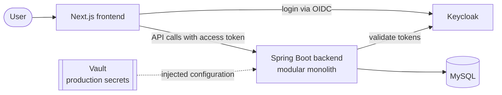

# Architecture Overview

- **Type:** spec
- **Module:** platform
- **Status:** draft
- **Owner:** ishanKulkarni13
- **Last updated:** 2026-10-27

> **Implementation:** planned. Observed today: a Spring Boot backend skeleton and a Compose MySQL ([implementation status](../product/roadmap/implementation-status.md)).

## Purpose

One page showing the intended building blocks and where the details live. It does not restate the details.

## Intended system context

Notes on the diagram:

- The login flow between the frontend and Keycloak is **not decided** (deferred to milestone 6); the arrow only shows that Keycloak authenticates users. See [authentication](identity/authentication.md).
- The dotted Vault arrow reflects a provisional decision: the platform injects secrets as configuration, and the app has no Vault client ([ADR 0016](../decisions/0016-platform-injected-secrets.md), draft).
- Nothing in this picture except the backend skeleton and MySQL exists in the repository.

## Building blocks

| Block | Role | Details |
|---|---|---|
| Backend | One deployable Spring Boot application, internally divided into features | [layers and boundaries](layers-and-boundaries.md), [ADR 0002](../decisions/0002-modular-monolith.md) |
| Frontend | Presentation and interaction; consumes deliberate API contracts | [milestone 6](../product/roadmap/milestone-6-frontend-integration.md) |
| Keycloak | Identity provider using OpenID Connect | [identity](identity/README.md) |
| MySQL | Relational persistence, schema owned by Flyway migrations | [data](data/README.md) |
| Vault | Production secret store | [secrets management](../operations/security/secrets-management.md) |

## Principles that shape the design

Backend authority, explicit boundaries, separate models, secure by default, no dependency without a purpose. Their statements live in [goals and non-goals](../product/goals-and-non-goals.md).

## Related

[Context and boundaries](context-and-boundaries.md), [communication](communication.md), [ADR index](../decisions/INDEX.md).
