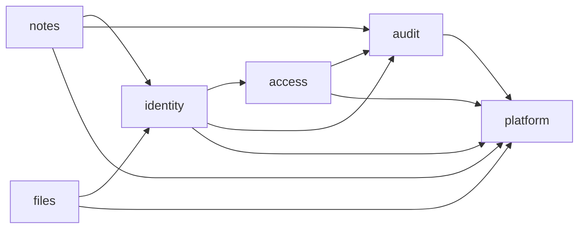

# Module Catalogue

- **Type:** reference
- **Module:** platform
- **Status:** draft
- **Owner:** ishanKulkarni13
- **Last updated:** 2026-11-24

> **Implementation:** observed. Read from the code on branch `m-5-1` (commit `75b2091`, 2026-11-24). The dependency declarations in the table below are enforced by `ModularityTest` (passed in a local run, 2026-11-24; CI run pending). The rest is a reading of the code and is not machine-checked, so it can drift: when a module changes, change this page in the same commit.

One page per fact, one row per module: what each module is for, what other modules may use from it, what it owns, and what it needs. The rules behind it are in [layers and boundaries](layers-and-boundaries.md) and [package structure](../engineering/conventions/package-structure.md); the data in each row is detailed in the [data inventory](data/data-inventory.md); what an enterprise would change is in the [architecture assessment](architecture-assessment.md).

## Dependencies between modules

Declared with `allowedDependencies` in each module's `package-info.java` since branch `m-5-1`, so a new edge fails `ModularityTest` until someone writes it down. `platform :: *` means every named interface of `platform`.

| Module | May depend on | Removable | Switch |
|---|---|---|---|
| `platform` | nothing | no | none |
| `audit` | `platform` | no | none |
| `access` | `audit`, `platform` | no | none |
| `identity` | `access`, `audit`, `platform` | no | none |
| `files` | `identity`, `platform` | yes | `kibootia.files.enabled` |
| `notes` | `identity`, `audit`, `platform` | yes, by deleting it | none (ADR 0024: no switch without infrastructure) |

`files` depends on `identity` only for the type `UserErased`. `notes` depends on `identity` only for the same type. Both are a listener of an event, not a use of identity's services.

### Runtime cycles that this graph does not show

The compile-time graph is acyclic. At run time three calls go back up through ports that `platform` hosts, which is how the cycle was avoided on paper ([assessment](architecture-assessment.md#modularity-cohesion-and-coupling), finding C-1):

| Call | Path | Hosted in |
|---|---|---|
| Is anyone else still an active administrator? | `identity` → `access` (`RoleAssignments`) → `identity` (`UserDirectory`) | `platform.directory` |
| Show the actor's name in the audit viewer | `identity` → `audit` (`AuditLog`) ; `audit` → `identity` (`UserDirectory`) | `platform.directory` |
| Every `@RequiresPermission` | any module → `platform.authorization.Authorization` → `access` (`PolicyDecisionPoint`) | `platform.authorization` |

## What each module offers

"Contract" is what sits in the module's top-level package; sub-packages are private.

### platform

A technical kernel with 12 named interfaces: `authorization`, `directory`, `errors`, `events`, `files`, `jobs`, `observability`, `persistence`, `ratelimit`, `security`, `tenancy`, `web`.

- **Owns:** `event_publication` (Spring Modulith's outbox), `shedlock`, `processed_event`.
- **Offers:** the decision-point port and the `Authorization` facade; durable events and idempotent listeners; locked jobs and retention purge; persistence base classes (UUIDv7, tenant, audit columns, soft delete); the rate limiter; Problem Details and paging.
- **Holds things that belong to a feature:** `directory.UserDirectory` (identity's lifecycle), `files.FileCategory` (image rules), `ratelimit.RateLimitCategory` (feature buckets). See finding C-2 in the assessment.

### identity

- **Purpose:** profiles, `/me`, user administration through Keycloak, avatars, the request gate.
- **Contract:** `IdentityPermissions`, the event `UserErased`.
- **Owns:** `user_profile` (with `avatar_file_id`).
- **Provides:** `RequestGate` (as `ProfileGate`) and `UserDirectory` to `platform`.
- **Needs:** `access.RoleAssignments`, `audit.AuditLog`, `platform.files.StoredFiles` (optional), the Keycloak Admin API through its own port `IdentityProviderAdmin`.
- **Publishes:** `UserErased` (public); `UserInvited`, `UserAccountChanged`, `VerificationEmailRequested` (internal, handled by `UserEvents`).
- **Listens to:** its own events, to reach Keycloak.

### access

- **Purpose:** permissions, roles, assignments, the decision point.
- **Contract:** `AccessPermissions`, `RoleAssignments`, `RoleSummary`.
- **Owns:** `role`, `role_permission`, `role_assignment`, `role_permission_seed`.
- **Provides:** `PolicyDecisionPoint` (as `DefaultDecisionPoint`).
- **Needs:** `audit.AuditLog`; `platform.directory.UserDirectory` (implemented by identity).
- **Publishes / listens to:** nothing. Identity calls `removeAll` when a user is erased.

### audit

- **Purpose:** append-only audit log and its viewer; the failed-event administration.
- **Contract:** `AuditLog`, `AuditEntry`, `AuditPermissions`.
- **Owns:** `audit_entry`.
- **Needs:** `platform.directory.UserDirectory` (for names), `platform.events.FailedEventAdministration`.
- **Publishes / listens to:** nothing.

### files (removable)

- **Purpose:** object storage, upload checks, image renditions, reconciliation.
- **Contract:** `FilesPermissions`. The usable contract is `platform.files.StoredFiles`.
- **Owns:** `stored_file` and the bucket.
- **Needs:** the S3 API through its own port `ObjectStorage`.
- **Listens to:** `UserErased`, to delete a user's files.
- **When switched off:** `StoredFiles` has no bean and callers get 404 `files.disabled`. The table stays migrated. The listener is not registered, so an erased user's files rows and objects remain (finding D-5).

### notes (removable)

- **Purpose:** the example feature: notes with one picture each.
- **Contract:** `NotesPermissions`, events `NoteDeleted`, `NotePurged`.
- **Owns:** `note` (with `attachment_file_id`).
- **Needs:** `audit.AuditLog`, `platform.files.StoredFiles` (optional), `identity.UserErased`.
- **Publishes:** `NoteDeleted` (nobody consumes it), `NotePurged` (consumed by itself).
- **Listens to:** `UserErased`, `NotePurged`.

## Events

All listeners are `@DurableEventListener`: delivered after commit through Spring Modulith's registry, idempotent through `processed_event`, retried with back-off.

| Event | Published by | Consumed by |
|---|---|---|
| `UserErased` | `identity` (`ErasureStarter`) | `identity` (`UserEvents`), `files` (`FileEvents`), `notes` (`NoteEvents`) |
| `UserInvited`, `UserAccountChanged`, `VerificationEmailRequested` | `identity` | `identity` |
| `NoteDeleted` | `notes` | `notes` (logs only) |
| `NotePurged` | `notes` (`NoteRetention`) | `notes` (`NoteEvents`) |

## Related

[Layers and boundaries](layers-and-boundaries.md), [architecture enforcement](architecture-enforcement.md), [ADR 0039](../decisions/0039-spring-modulith-module-boundaries-and-outbox.md), [ADR 0024](../decisions/0024-package-modules-with-infrastructure-toggles.md).
