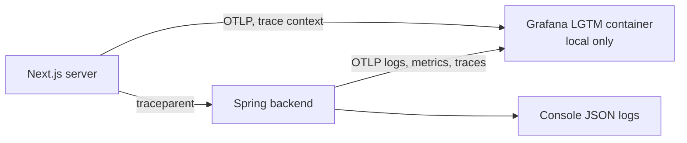

# Observability Baseline

- **Type:** spec
- **Module:** platform
- **Status:** draft
- **Owner:** ishanKulkarni13
- **Last updated:** 2026-11-25

> **Implementation:** partly observed, not verified in CI. Both applications export traces over OTLP to Grafana LGTM; a single trace was seen in Tempo covering the Next.js proxy call and the Spring request, with the Spring span as a child of the Next.js `fetch` span (locally, 2026-11-09). Both print JSON logs carrying the trace ID. **Gap:** OTLP log export is not wired, in Spring or Next.js, so logs reach Grafana only through the console (OQ-42). Metrics from Spring are exported over OTLP; nothing is scraped.

Decision: [ADR 0030](../../decisions/0030-otlp-telemetry-and-local-lgtm.md).

## Scope (owner decision of 2026-10-28)

The foundation provides logs, metrics, traces, request correlation and health checks, and a local stack to see them. This replaces the earlier scope of basic logging, correlation and health only.

## Design

| Signal | How |
|---|---|
| Logs | Structured JSON on the console always, carrying trace and span IDs; also sent over OTLP when the stack is on |
| Metrics | Micrometer, exported over OTLP |
| Traces | OpenTelemetry, with W3C trace context passed from the Next.js server to Spring, through the outbox and into jobs |
| Correlation | The trace ID doubles as the request correlation ID, visible in logs and available to callers |
| Health | Actuator liveness and readiness on a separate internal management port; readiness checks MySQL only. The Next.js server has `/healthz` ([ADR 0047](../../decisions/0047-health-exposure-and-container-images.md)) |

The application emits OTLP only. Where it goes is deployment configuration, so there is one telemetry path and no duplicate collectors.

## Metrics the application defines

Besides what Spring Boot and Micrometer report, the application counts what a person on call asks about first (ADR 0061, assessment R-10). Each is exported over OTLP with the rest and works without a registry, so a test that builds a class by hand needs none.

| Metric | Kind | Tags | Says |
|---|---|---|---|
| `kibootia.authorization.decisions` | counter | `outcome`, `reason`, `action` | Every authorization decision; a rise in `deny` is someone refused (milestone 7) |
| `kibootia.events.failed` | gauge | none | Events that failed and were not delivered since, in every tenant; alert when it stays above zero ([ADR 0059](../../decisions/0059-data-integrity-in-the-database.md)) |
| `kibootia.keycloak.calls` | timer | `operation`, `outcome` (`success`, `answered` for a 404 or 409, `failure`) | Each call to the Keycloak Admin API, a repeat counted each time; a rise in `failure` is Keycloak slow or down ([ADR 0058](../../decisions/0058-no-external-call-inside-a-database-transaction.md)) |
| `kibootia.storage.errors` | counter | `action` | Calls to the storage server that failed, by what was being done |
| `kibootia.ratelimit.rejections` | counter | `category` | Requests the in-app rate limiter refused; a rise says someone is using up an allowance |
| `kibootia.retention.removed` | counter | `purge` | Rows each retention purge removed |
| `kibootia.retention.failures` | counter | `purge` | Runs of a retention purge that failed |

Not yet shown in a Grafana dashboard: the metrics are tested to be recorded, and a local stack with `observability` on exports them, but no dashboard is provisioned and no alert rule is written.

## Local and production

- **Locally:** one Grafana LGTM all-in-one development container starts with `docker compose up`. It can be switched off with a property and a Compose profile; the application then keeps logging to the console.
- **Production:** the same OTLP settings point at a managed backend or a self-hosted collector with Prometheus, Tempo, Loki and Grafana. That is a planned recipe, not shipped. Retention, access control, alerting and sizing are the deployer's responsibility. The local container is never a production component.

## Requirements

- Logs and traces must not contain secrets, tokens or other sensitive data ([API conventions](../../architecture/api/conventions.md)).
- Health endpoints are never public: the management port is not exposed by the reverse proxy ([ADR 0047](../../decisions/0047-health-exposure-and-container-images.md)).
- OTLP log export is not wired. Boot 4.1.1's exporter needs OpenTelemetry's Logback appender (`opentelemetry-logback-appender-1.0`, an alpha-versioned artifact), which `spring-boot-starter-opentelemetry` does not include ([open questions](../../decisions/open-questions.md)).

## Resolved deviation

`spring-boot-admin-starter-server` was unintended and was removed from `pom.xml` in milestone 0. It is not part of this baseline.

## Related

[Milestone 1](../../product/roadmap/milestone-1-walking-skeleton.md).
