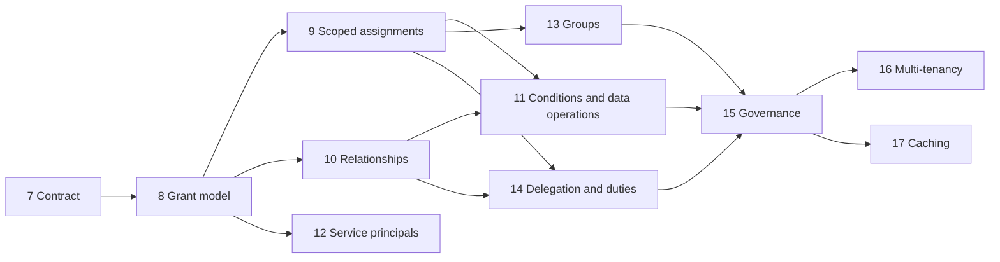

# Authorization Roadmap

- **Type:** spec
- **Module:** platform
- **Status:** draft
- **Owner:** ishanKulkarni13
- **Last updated:** 2026-11-11

> **Implementation:** planned. No phase is built. What exists today is in [traceability](../requirements/authorization/traceability.md).

How the [authorization requirements](../requirements/authorization/README.md) are delivered on top of what milestones 0 to 6 built. The scope is committed by draft [ADR 0053](../../decisions/0053-adopt-authorization-requirements.md); this document is the order. It is a proposal awaiting the owner's review; no implementation starts until the owner authorizes it.

Kibootia is not starting again. The authorization built in milestones 2 and 3 is kept and evolved; nothing is rewritten that does not have to change.

## What every phase must leave behind

If work stops after any phase, Kibootia:

1. builds, and starts from a fresh clone;
2. migrates from an empty database **and** from the schema of the phase before;
3. keeps every function that worked before the phase, proven by the existing tests;
4. has no broken module boundary (`ModularityTest`, `ArchitectureTest`);
5. has allowed and denied tests for everything the phase added;
6. has its documents updated, including [traceability](../requirements/authorization/traceability.md) and [implementation status](implementation-status.md);
7. passes in CI, including the `module-removal` job ([verification standard](../../engineering/testing/verification-standard.md)).

Three more rules hold throughout:

- **A phase starts only when its ADRs are accepted.** The ADR for a phase is written when the phase starts.
- **Every capability beyond today's baseline has a switch**, a recipe and a CI row proving the application starts with it off (AUTH-040, [ADR 0024](../../decisions/0024-package-modules-with-infrastructure-toggles.md)). The baseline is what works today: roles, permissions and ownership.
- **No compatibility shims.** Kibootia has no forks and no users (owner, 2026-11-11). A change to the contract or to stored data is made directly, with a tested migration. Where a phase needs a temporary bridge inside itself, the phase file names it and removes it before the phase ends.

## How the built milestones map onto the new phases

| Built milestone | What it delivered for authorization | Kept as it is | Modified | Replaced |
|---|---|---|---|---|
| 0 Hygiene and guardrails | Modulith verification, ArchUnit rules | All of it | Rule 7 gains a companion startup check (M8); a rule for tenant-less SQL (M8) | Nothing |
| 1 Walking skeleton | Token validation, the BFF session, the `/api` proxy | Signature, issuer, expiry and audience checks; the BFF | The machine-token check and the token-to-principal mapping (M12); two frontend defects (M7) | Nothing |
| 2 Platform conventions | The decision point port, `can` and `scopeFor`, the annotations, tenancy, the audit module, system authority for jobs | The port and its place in `platform`; checks on use cases; the tenant filter; the audit module | The audit entry gains a second identity (M14); tenancy becomes live (M16) | The contract's shape: boolean, untyped resource, three-value scope (M7); the all-powerful system caller (M12) |
| 3 Identity and access administration | Stored roles, role and assignment administration, safeguards, the request gate, the administration screens | Roles as runtime data; the safeguards; the request gate; the screens | Assignment gains the "only what you hold" rule (M7), then scope and validity (M9); the administrator becomes an explicit role (M8); the profile key gains an external subject (M12) | `role_permission` rows by `role_grant` rows (M8) |
| 4 Files | Avatars with a permission check on every view | All of it | The check moves to the new contract (M7); no change in behavior | Nothing |
| 5 Example feature (Notes) | The worked example of ownership, list scope and 404 hiding | Its role as the worked example | Migrated in each phase so the guide stays true; `-any` permissions removed (M8) | Nothing |
| 6 Production readiness | Not built | Its content | Its "policy engine (OPA)" recipe becomes "an external engine behind the decision point"; its threat model covers what is built by then | Nothing |

## Phases

One file per phase, each with the same thirteen sections. "Reference" says whether a Timetia or indent-edi scenario exercises the phase ([reference scenarios](../requirements/authorization/reference-scenarios.md)).

| Milestone | Phase | Requirements | Schema change | Reference |
|---|---|---|---|---|
| [7](milestone-7-authorization-contract.md) | Decision contract; the role-assignment fix; denial records | AUTH-020, 031, 034, 036, part of 022 and 028 | None | Both |
| [8](milestone-8-grant-model.md) | Grant model: declared resource types and action kinds; grants with a reach replace `-any` | AUTH-001, 003, 010, 038 | Role permissions to role grants | Both |
| [9](milestone-9-scoped-assignments.md) | Scoped assignments: scope nodes, records in several scopes, validity, inheritance, list filters | AUTH-004, 007, 008, 016, 021, 024, 045, 051 | Scope nodes; wider assignments | Both |
| [10](milestone-10-relationships-and-ownership.md) | Relationships and ownership; per-record audit history | AUTH-005, 009, 016, 044, 046, 047 | Relationship records | Timetia |
| [11](milestone-11-conditions-and-data-operations.md) | Named conditions; field-level rules; bulk, export and print | AUTH-006, 011, 014, 015, 043, 048, 049 | Conditions on grants | Both |
| [12](milestone-12-service-principals.md) | Service principals and identity mapping; end of the all-powerful system caller | AUTH-018 (service), 035, 039 | Service principals; external subject | None |
| [13](milestone-13-groups.md) | Groups, nesting, membership sources | AUTH-018 (groups), 019 | Groups and membership | None |
| [14](milestone-14-delegation-and-duties.md) | Delegation, separation of duties, reviewer rules | AUTH-012, 013, 026, 041, 042 | Delegations; duty rules; audit identity | Timetia, partly |
| [15](milestone-15-administration-and-governance.md) | Bundles, administrator hierarchy, definition lifecycle, approval of changes, decision log | AUTH-002, 022, 025, 027, 028, 029, 030, 050 | Definition versions; pending changes; decision log | None |
| [16](milestone-16-multi-tenancy.md) | Live multi-tenancy | AUTH-017, 028 (tenant level) | Tenants | None |
| [17](milestone-17-caching-and-guarantees.md) | Measured targets; a cache only if needed | AUTH-032, 033 | A version counter, only if a cache is built | None |
| Later | Simulation and impact analysis | AUTH-023 | | None |

AUTH-037 (the Java contract and the OpenAPI-described administration API), AUTH-040 (a switch per capability) and AUTH-050 (an audit entry for every administrative change) are obligations of every phase, not phases of their own.

## Order

- **7 and 8 first, in that order.** Everything else stands on them. They are separate so that the interface and the stored permissions never change in the same phase.
- **9 and 10 are independent of each other.** Timetia needs both; indent-edi needs 9. Either order works; 9 first is proposed because list filtering by scope is needed by both.
- **12 can move earlier.** It depends only on 8, and it removes the all-powerful system caller, which is a security improvement in its own right.
- **13 to 17 have no reference scenario.** They are committed scope, built from the requirement text, after the phases a reference application exercises.
- **Milestone 6** (reference deployment and first release) keeps its content. It is proposed after milestone 8, so the first release tag carries the new contract and the new stored model; it can be built at any later point without affecting the order above.

## The engine measurement

Draft [ADR 0056](../../decisions/0056-authorization-evaluation-engine.md) is confirmed or overturned by a measured comparison of the in-house approach with OpenFGA and Cerbos on two reference scenarios. It runs during milestone 7, outside the main code, and its result is needed before milestone 9 starts, because milestone 9 is where hierarchy queries are first written.

## Size

Eleven phases against the six milestones built so far. Milestones 8, 9, 10 and 15 are each comparable to milestone 3, the largest so far. Because every phase ends in a usable state, the work can stop after any of them: after milestone 9 Kibootia covers everything indent-edi asks for, and after milestone 11 everything read in Timetia's documents.
